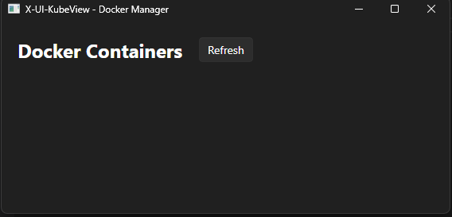
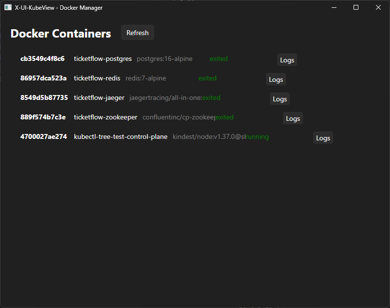
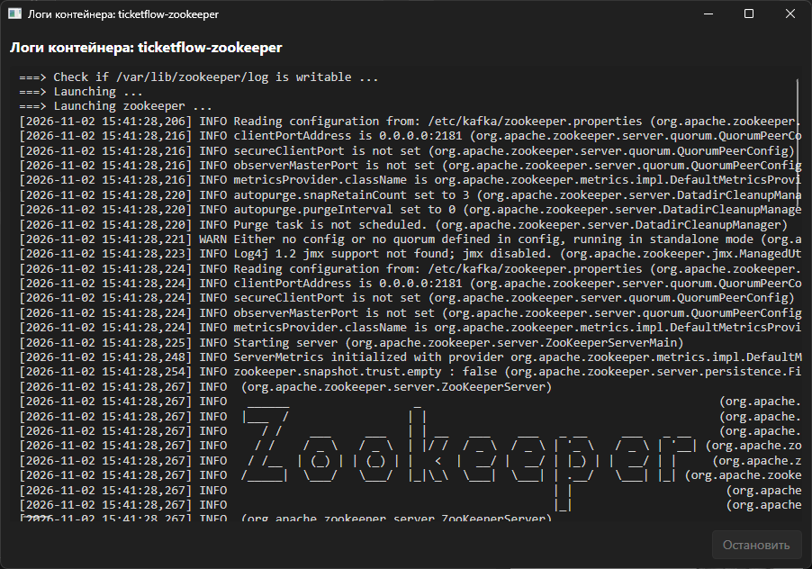

# X-UI-KubeView

> Lightweight cross-platform desktop client for Docker Engine, built with **.NET 11** and **Avalonia UI**.
> Designed for developers who work with Docker in WSL2 and need a fast, native GUI alternative to Docker Desktop.


---

## Why this project?

Most Docker GUIs are Electron-based and heavy. X-UI-KubeView is a **native .NET 11 desktop app** that talks directly to the Docker Engine API over TCP. It was built to solve a real pain point: **managing containers running inside WSL2 from a Windows host without Docker Desktop overhead**.

This project demonstrates production-grade engineering practices:
- Clean Architecture with strict layer separation
- CQRS pattern via MediatR
- Reactive streaming of logs via `IAsyncEnumerable<T>`
- Proper `CancellationToken` propagation across all async boundaries
- Unit tests with mocks (no real Docker required)
- Configurable endpoints (WSL2, Docker Desktop, remote daemon)

---

## Features

| Feature | Status |
|---|---|
| List all containers (running + exited) | ✅ |
| Stream logs in real time (`docker logs -f` equivalent) | ✅ |
| Start / Stop containers from UI | ✅ |
| Configurable Docker endpoint (`tcp://`, `npipe://`, `unix://`) | ✅ |
| Works with Docker in WSL2 | ✅ |
| Works with native Docker Desktop on Windows | ✅ |
| Unit tests for Application layer | ✅ |
| Kubernetes support | 🚧 Roadmap |
| Live metrics (CPU / RAM) | 🚧 Roadmap |
| `exec` into container | 🚧 Roadmap |


## Getting Started

### Prerequisites

- Windows 11 with WSL2 (or any OS with a reachable Docker daemon)
- .NET 11 SDK
- Docker Engine running inside WSL2 (see below) or Docker Desktop

### 1. Configure Docker in WSL2 to listen on TCP

By default, Docker in WSL2 only listens on a Unix socket. To expose it to the Windows host, create a systemd override:

```bash
sudo mkdir -p /etc/systemd/system/docker.service.d
sudo tee /etc/systemd/system/docker.service.d/tcp.conf <<EOF
[Service]
ExecStart=
ExecStart=/usr/bin/dockerd -H fd:// -H tcp://0.0.0.0:2375 --containerd=/run/containerd/containerd.sock
EOF

sudo systemctl daemon-reload
sudo systemctl restart docker
```

### Run in PowerShell:
`Invoke-WebRequest -Uri "http://localhost:2375/version" -UseBasicParsing`

### For Native Desktop Use:
`{ "Docker": { "Endpoint": "npipe://./pipe/docker_engine" } }`

### Build and run:
`dotnet build`
`dotnet run --project src/X-UI-KubeView.Desktop`

### Run tests:
`dotnet test`

### Before refresh:


### After refresh:


### list of containers in wsl2:


### log of certain container


### you can see logs, run or even stop containers


